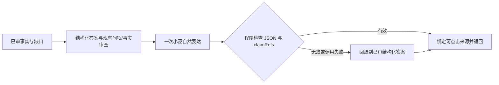

# 联网轻量可用版：先保住小巫表达

> 功能名称：联网回答轻量表达路径  
> 状态：已实施，离线验证通过；真实模型和用户入口尚未验证  
> 最后核对代码：2026-10-11，d9e3 工作树

## 你会感觉到什么

联网回答通过证据与问项检查后，小巫只生成一次自然中文答复。程序会检查段落/来源引用格式、每个用户问项是否覆盖、已有事实要点是否被提及，以及所有已审核信息缺口是否保留；格式或覆盖检查失败、表达调用失败时，回退到已有的来源绑定答案。

轻量版优先看“切题、意思大体对、说话像小巫、格式清楚”。细节覆盖不要求完美；事实和引用仍沿用现有答案审查，明确的人物/版本/条件疑点仍应保留不确定说法。

## 当前位置

原路径在自然表达后还调用模型做忠实度审查；审查拒绝、超时或格式错误时，最终回退到结构化答案。这个额外审查无法验证事实本身，且会让已审核的内容重新变成卡片式表述。

## 本次触及的位置

## 计划或完成后的状态

| 项目 | 当前 | 本次触及 | 状态与用户可见变化 | 验证/边界 |
|---|---|---|---|---|
| 自然表达 | 表达生成后再调用 GLM 独立审查；有问题时退回结构答案 | 只做一次表达生成；将可安全合并的短段收拢到最多3段/700字；事实要点可省次要项，但每个用户问项都要覆盖，有事实时至少保留一条事实；所有信息缺口都要保留；无法满足格式时退回结构答案 | 已实施；自然表达不再等待第二次模型审批，也不必逐条复述所有已核准事实 | 离线 `glm-smoke` 验证事实问项覆盖、缺口保留、次要事实可省、短段合并和超长退路，并重放日落海 `06-59-54-287Z` 的表达：缺失体验服/正式服和两种描述关系的限制时被拒绝，补齐该 gap 后可通过格式检查；没有真实 GLM、真实检索或 QQ 验收 |
| 来源绑定 | 程序根据 claimRefs 添加来源和链接 | 保持原机制 | 未改变 | 离线测试检查引用仍由程序绑定 |
| 事实与问项审核 | 原引用校验只确认 quote 存在且来源有 URL，模型仍可把别的问项事实卡上的真引文绑定过来 | 每条 claim 的引用事实卡必须与该 claim 至少共享一个 `requestedPointId`；不满足的 claim 会被舍弃并进入既有缺项修复/退路 | 已实施；这是结构防错，不能替代引文蕴含核验 | 离线 smoke 覆盖跨问项错绑拒绝和同问项正常通过；真实模型修复行为未验证 |
| 比较与同名实体 | “棋手与上阵英雄的区别”可能被压成一个问项，单侧引文被拿来回答另一侧 | 规划与范围审查要求把用户明确要求比较的每一侧拆成独立问项；每个 claim 必须逐项引用对应卡片，缺失侧必须绑定自己那一项的 insufficient 卡 | 已实施；程序检查每个 claim/limitation 的每个问项都有同 ID 卡片引用 | 离线 smoke 覆盖只给棋手证据时拒绝回答英雄侧，以及正确逐侧引文/缺口；真实规划模型是否稳定拆分未验证 |
| 机制角色 | 日落海回答把等级提供者阿科米娅和等级转化受益者司空震的分工概括成单一“核心” | 合成与答案审查提示要求按原文区分触发者、资源提供者、转化者和受益者；来源没说明主次时用中性描述 | 提示规则已实施；不增加题目专属分支，也不代表程序可自动识别语义角色 | 离线 smoke 检查提示约束；真实模型是否能稳定遵守未验证 |
| 回答篇幅 | 保存回答多次扩成资料整理，逐条复述次要事实和检索边界 | 提示目标为普通问题1–2段、100–300字；多问项通常最多3段、450字。程序将可合并短段收拢，硬限3段、单段400字、总字数700字；无法满足时回退到已核实的结构化答案 | 提示允许略去同一问项的次要事实；每个问项仍需覆盖，每条信息缺口必须保留，且来源引用由程序绑定 | 离线 smoke 覆盖简洁答案、次要事实省略、缺口/问项覆盖、短段合并和超长退路；新提示下真实模型风格仍未验证 |

## 风险和验证

自然表达不再被另一个模型审查，因此可能轻微改写条件或添加不受支持的过渡语。程序仍不能证明表达文字完全忠于事实。人工核对保存答案发现马可题回合运营 claim 引用到了机制卡，且棋手/上阵英雄区分缺少后一侧直接证据；较早日落海答案也曾把不受引文支持的 reviewerNotes 风险扩成事实。星痕样本的 quoteId 误判则是我人工看反，已纠正记录。现在比较两侧要求拆成独立问项，每个 claim 的每个问项必须有同项卡片引用；同名侧证据缺失时，只允许用该侧 gap 回答。篇幅校验会把能合并的短段收拢；超长或不能安全收拢的表达回退到已核实结构答案。由于退路可能仍较长，它不等于保证每条回答都像小巫。真实提示下风格和退路长度都未做模型验收，不能宣称达标。没有调用新 API。

本次没有调用外部搜索或模型 API，没有更改正式 `.env`、部署、重启或发送 QQ。
