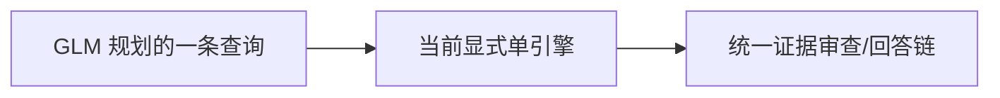
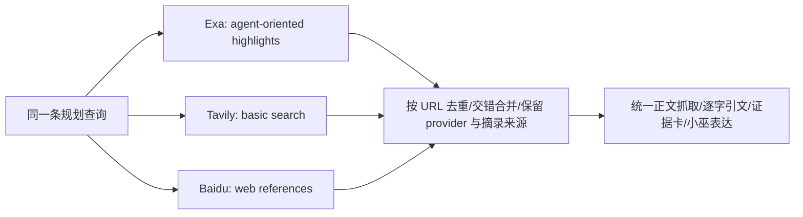
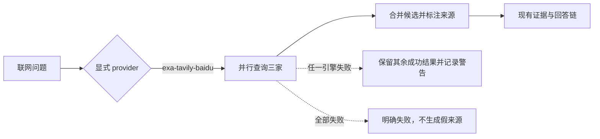

# Exa、Tavily、百度检索对照与可选三引擎路由

> 功能名称：固定题材搜索结果对照与 Exa+Tavily+百度候选融合  
> 状态：三引擎路由与回答链持续实施；离线 smoke 已复跑；四题检索层真实对照完成；电影、日落海、一般游戏保存结果回放机械通过但待人工审；马可复测受 GLM 安全拦截，整体尚未通过
> 最后核对代码：2026-10-11，当前工作树未提交

## 你会感觉到什么

新增显式 provider `exa-tavily-baidu`，让同一条规划查询可并行送到 Exa、Tavily 和百度；来源会去重并保留每家搜索引擎的出处标记，后续仍由 Witch 的统一证据链核原文。它不会自动开启，也不会把三家的搜索结果直接拼成答案。

## 当前位置

百度之前仅能单独选用；已有 Exa+Tavily 组合，但缺少三者并行的配置路径。搜索结果丰富不等于已完成网页核验或答案验收。

## 本次触及的位置

## 计划或完成后的状态

## 变化清单

| 项目 | 当前 | 修改后 | 状态 | 代码依据 |
|---|---|---|---|---|
| provider 配置 | 百度只可单引擎使用 | 可显式选 `exa-tavily-baidu`，三把 key 缺任一则启动配置报错 | 已实施，默认不变 | `src/config.ts`、`src/index.ts` |
| 结果融合 | Exa/Tavily/Brave 组合 | 合并器可在原组合基础上接入百度；按 HTTPS URL 去重，保留 `searchProviders` 和逐 provider 摘录 | 已实施，离线测试待本轮运行 | `src/brain/web-search.ts`、`scripts/web-search-smoke.mjs` |
| 真实检索对照 | 各 provider 质量未知 | 四个固定查询各向 Exa/Tavily/百度请求一次 | 已完成，仅检索层 | `scripts/web-search-provider-compare.mjs` 与生成报告 |
| 完整回答验收 | 电影题已有未通过证据 | 三引擎整链、人工事实和小巫人格验收仍未完成 | 待验证 | `scripts/web-search-live-acceptance.mjs` |

## 整链验收与发现的问题

三引擎真实整链目前已运行两题，不能据此称“基本可用”：

- “日落海倒转”：14 次搜索服务请求（Exa 4 次 `/search`、2 次 `/contents`；Tavily 4 次；百度 4 次）与 9 次 GLM。机械检查通过，但报告仍要求人工事实审阅；回答较像资料整理，且“没找到官方名称”有把检索缺席说成否定事实的风险。报告：`runtime/web-search-acceptance/exa-tavily-baidu-live-2026-10-11T05-22-45-366Z.json`。
- “马可养猪流”：10 次搜索服务请求（Exa 3 次 `/search`、1 次 `/contents`；Tavily 3 次；百度 3 次）与 4 次 GLM。失败原因是证据审查输出达到 token 上限，修复轮沿用截断原文并再次截断，最终未能生成达到最低长度的回答。报告：`runtime/web-search-acceptance/exa-tavily-baidu-live-2026-10-11T05-27-06-252Z.json`。

据此实施结构性输出限制：证据卡最多 8 张、每卡最多 3 条短引文；输出截断后的修复不再回灌残缺长 JSON，而是基于同一批来源重新生成精简 JSON。此修复不能删减核心问项或冲突证据，需用本地回归及已保存的马可来源回放复验。

本轮对照前后，按报告和逐次请求日志累计核账：Exa 476 次（含 search/contents）、Tavily 11 次、百度 12 次，复合计数 499；两次保存结果回放后 GLM 累计1138次。它们是本机脚本的累计调用数，不是供应商账户余额。三引擎预算总上限仍512，因此仅剩13次搜索服务调用预算；GLM硬上限1149，尚有11次本地验收预算。

修复后两份保存材料回放：马可报告 `runtime/web-search-acceptance/glm-retrieved-answer-2026-10-11T05-38-24-653Z.json` 使用11次GLM；日落海报告 `runtime/web-search-acceptance/glm-retrieved-answer-2026-10-11T05-42-04-661Z.json` 使用15次GLM。两者均没有新搜索请求或正文抓取，状态都是 `mechanical-passed-needs-manual-fact-review`。回答能区分来源限制、版本缺口和相邻术语，但日落海仍经历多轮审查重写，最终表述依然偏长、像研究报告，且需要人工核对所有机制与引文；这只证明输出截断修复在两份已存样本上可运行，不证明全面事实准确或完全符合小巫自然表达。

## 检索层对照记录

固定查询覆盖“日落海倒转”“马可养猪流”“哪吒电影资料”“星痕共鸣”。12 次搜索请求均成功：Exa 4 次，响应报告费用合计约 `$0.028`；Tavily 4 次 basic search，共 4 credits；百度 4 次。百度控制台的免费额度剩余数与是否已进入后付费状态未核实，因此不把它们宣称为零成本。

- 日落海：三家都找到了玩法材料，但候选涉及官方基础规则、社区攻略、视频和可能的转载；不能仅凭搜索摘要确认“倒转”具体触发条件。
- 马可养猪：三家都命中了玩法，Exa 有较结构化的知识库/运营手册候选，Tavily 和百度还带来不同攻略页；这些页面是否互相转载、适用版本是否一致，尚未查正文。
- 哪吒电影：百度返回较直接的上映日期和主创条目，Exa/Tavily 候选更分散；三家这次都没有返回已知片方公告 PDF，因此官方来源要求仍未满足。
- 星痕共鸣：Exa/Tavily 返回官方或发行相关候选，百度结果混入旧称和泛攻略，说明来源/时效筛选不能交给搜索排序。

原始报告只保留标题、HTTPS 链接、日期和每条最多 600 字的搜索摘录；没有抓取网页正文、调用 GLM、记录 API key 或修改正式配置：`runtime/web-search-provider-compare/provider-compare-2026-10-11T05-15-36-075Z.json`。

## 没有改变什么

- 没有改联网意图判断、查询规划、事实卡、来源可信度判断、自然表达或 QQ 权限。
- 没有将 provider 排名当成真实性/独立性，不把同 URL 重复命中算作多来源印证。
- 没有改正式 `.env`、切换正式 provider、同步正式目录、部署、重启或发送 QQ。

## 风险和验证

| 可能出错的位置 | 用户看到的表现 | 隔离或回退方式 | 验证方法 | 结果 |
|---|---|---|---|---|
| 增加引擎造成重复或噪声候选 | 更多结果但答案更差 | URL 去重，继续共用来源/事实审核；provider 显式 opt-in | 三引擎 mock 与同题真实检索对照 | 检索对照已完成；离线 smoke 待运行 |
| 搜索摘要与页面正文不一致 | 错误引用或漏事实 | 现有正文抓取及逐字核引文仍是回答前置 | 完整 live acceptance + 人工核对 | 日落海机械通过但待人工审；马可题证据审查截断失败 |
| 百度免费额度耗尽或账户已开后付费 | 产生费用或被限流 | 控制台核对余额；每轮请求受本地累计上限约束 | 百度控制台账单/额度页 | 未核实 |
| 三引擎增加延迟和请求量 | 一次回答发出多家搜索请求 | 仅显式启用；现有复合失败隔离和请求预算 | 预算 smoke 与低限额现场验收 | 两题真实验收计数已纳入预算；离线测试需复跑 |

官方接口/额度依据：[Exa pricing](https://exa.ai/pricing)、[Tavily credits](https://docs.tavily.com/documentation/api-credits)、[Baidu Search API](https://ai.baidu.com/ai-doc/AppBuilder/pmaxd1hvy) 与 [百度搜索计费](https://ai.baidu.com/ai-doc/AppBuilder/Imca18xc6)。额度及费率会变化，以供应商控制台为准。

## 下一步

先跑构建、`web-search-smoke` 和完整离线 smoke；然后只用已保存的三引擎马可来源做 GLM 回放（不发搜索请求），核验截断修复、回答完整性和来源绑定。之后是否再做线上检索题需看仅剩的 13 次 provider 预算，并继续以人工事实审查与小巫表达为门槛；任何关键题不通过，都不能将联网标为基本可用，也不切正式 provider。

## 最新续测与实施（2026-10-11）

三引擎马可题续测新增13次 provider 请求（Exa +5、Tavily +4、百度 +4）和5次 GLM。证据审查首次因 token 上限截断，修复审查完成后触发两条补搜（每条三引擎并行），第三次证据审查在35.9秒后超时；没有进入自然回答阶段。当前本机累计 Exa481（含搜索/正文抓取）、Tavily15、百度16，共512次 provider；GLM1143次。该结果确认问题是“候选和审查负载未按多引擎成本收敛”，并非缺少搜索返回。

据此把真实 distinct provider 数纳入证据预算：单/双/三索引最多12/10/9个来源；三索引最多补搜1条，单/双索引最多2条；每卡最多2条引文。保存材料回放中，来源压至9条后，证据审查仍在3072 token输出上限截断，因此阶段上限提高到6144。此调整不放宽逐字引文校验、来源独立性、缺口记录或最终答案审查。

新本地测试 hard cap 为560 provider / 1193 GLM，默认新增仍为0、单轮最多+50。阶段上限提升后的回放仍须验证；仅当回答阶段能完整运行，才使用小额明确上限继续日落海/电影/一般游戏验收。以上实施后的真实表现尚未验证；不得据此宣称联网已基本可用。

### 保存结果回放续测

实现后前两次用该三引擎报告作零搜索 GLM 回放，共新增8次 GLM并分别因截断/格式验证失败。第三轮将审查阶段输出上限由3072提高至6144，并在归一化时保留最多2条来源核验过的引文，即便模型多生成少量多余引用也不丢弃整个证据包；回放完整运行 planner、scopeReview、evidenceReview、synthesis、answerRelevance、answerAudit、expression、expressionAudit 八阶段，共8次 GLM，机械状态通过但仍待人工事实/风格审查。

电影题三引擎 live acceptance 新增14 provider（搜索12、正文抓取2）和11 GLM；累计 Exa487、Tavily19、百度20、provider526，GLM1174。搜索找到光线传媒公告相关的一手披露平台与媒体转述，但答案审核提示了日期/来源归属问题；随后审核输出超时，未进入自然表达。定位到 `auditResearchAnswer` 单次输出上限只有1400 tokens，难以完整输出针对多条主张与限制的审查意见，本次提高至3000并补离线断言。此项实施后的 live 效果仍待保存结果回放验证。

### 后续质量复验与边界

在既有数据上继续完成了以下受控验证；保存结果回放不新增搜索服务调用：

- 电影题回放首次机械通过但事实归属仍降格为百科来源。补充“事后媒体明确转述公告时优先使用该媒体原句，同时保持媒体转述身份”的一般规则后，第二次回放用12次 GLM，零 provider 请求；回答正确区分 1 月 29 日公映、澎湃新闻转述 2 月 5 日光线传媒公告、媒体页面发布于 2 月 6 日，以及未直接取得公告原页的缺口。报告 `runtime/web-search-acceptance/glm-retrieved-answer-2026-10-11T06-46-53-035Z.json`，仍需人工逐条核对正文和风格。
- 一般游戏“星痕共鸣”三引擎实测新增8次 provider（Exa +4、Tavily +2、百度 +2）及14次 GLM；候选包含上线报道、商店页和社区资料。首次回答阶段过度扩写后被逐字引文审计拒绝，最终审计阶段超时，整链失败，报告 `runtime/web-search-acceptance/exa-tavily-baidu-live-2026-10-11T06-48-58-158Z.json`。同一保存结果零搜索回放10次 GLM，先暴露“只答类型/家园而遗漏其他已核实玩法模块”；补充范围型问题的事实卡覆盖规则后再回放10次，回答覆盖战法牧/多人副本、职业、20人副本、家园与首测时点差异，并把核心循环和当前版本标为缺口。报告分别为 `runtime/web-search-acceptance/glm-retrieved-answer-2026-10-11T06-53-49-711Z.json` 与 `runtime/web-search-acceptance/glm-retrieved-answer-2026-10-11T06-56-32-428Z.json`；第二次仅机械通过，仍需人工核对每条引文与当前版本适用性。
- 闲聊负例用2次 GLM、0次 provider，路由为不搜索并给出自然陪聊回应；报告 `runtime/web-search-acceptance/exa-tavily-baidu-live-2026-10-11T06-58-58-385Z.json`。日落海倒转保存结果用8次 GLM、0次 provider，机械通过；回答把社区玩法名、临时等级触发条件、版本缺口和另一种“倒转”表述的不确定性分开，报告 `runtime/web-search-acceptance/glm-retrieved-answer-2026-10-11T06-59-54-287Z.json`。这仍不是正式 QQ 验收。
- 马可保存结果复验9次 GLM后机械通过，但人工复核发现：来源只支持“棋手马可”的宝藏机制，回答却断言“上阵英雄马可波罗”存在并描述为战斗棋子，审计器没有拦截。已增加同名实体/角色两侧均需原文支持的回答与审计要求。接着复验时，一次因模型生成未绑定问项/来源的风险备注而安全失败；已改为只保留结构、来源、问项均验证通过的风险备注，并由离线 smoke 覆盖丢弃行为。之后 GLM 对游戏攻略证据审查返回 HTTP 400 内容安全拦截，未进入答案阶段；未尝试改写请求绕过该拦截。两份最新复验为 `runtime/web-search-acceptance/glm-retrieved-answer-2026-10-11T07-02-11-529Z.json`、`runtime/web-search-acceptance/glm-retrieved-answer-2026-10-11T07-10-01-279Z.json`。
- 检查到正式 `.env` 已有 DashScope key 与百炼应用 ID，但三个 `ALIYUN_RESEARCH_*_ENABLED` 开关均为 false；它当前不是 Witch 已接入的搜索提供方。按阿里官方新版应用 API 文档，以隔离的一次调用测试公开问题，返回 HTTP 401 `InvalidApiKey`，没有得到模型/搜索结果；不据此更改正式配置，也不将其算作成功后备。该 API 的官方入口和参数见[百炼新版智能体应用 API 参考](https://help.aliyun.com/zh/model-studio/new-agent-application-api-reference)。

截至本次核账，本机累计 Exa491（含 search/contents）、Tavily21、百度22，共534次 provider；GLM累计1264次。本地上限为560 provider / 1291 GLM，默认新增为0、单次最多+50；当前本地余量分别26、27。此为本机 acceptance 计数，不等于供应商账单或账户余额。Codex 账户周窗现场显示已用3%，高于用户要求的“剩余10%即停止”安全线；未触发该停止条件。

当前结论：多引擎确实扩大了召回，电影、日落海、一般游戏与不应联网的闲聊负例均已得到可用的机械回放结果；但马可案例暴露模型审计漏掉实体外推，后续还受供应商内容安全拦截，其他回答也尚未完成逐条人工事实审阅。因此不能宣称联网已经基本可用；未改正式 `.env`、未部署、未重启、未发 QQ。后续先解决马可证据覆盖/提供方拦截的正式路径，再逐来源人工核查日落海、电影和一般游戏回答；任何上限外调用都须再次记录并保持单次封顶。

### 近重复转载的来源独立性

复核代码发现旧证据分组只识别规范化 URL 与完全相同正文；跨站转载若添加导语/页脚，可能被错误地算作独立来源。现新增仅用于来源关系的保守长正文近重复检测：对至少800字符的正文生成5字符 shingles，只有 Jaccard 相似度不低于0.82或较短正文被较长正文覆盖不低于0.94时才合并证据组；短摘录不参与该判断。它不是语义相关性分数，也不能证明未合并页面相互独立。离线回归覆盖“带编辑导语的长转载合并”与“同题独立描述不合并”。此次不调用搜索/模型、不改变正式配置。

### 本地模型后备能力探测

为避免仅因 GLM 对“马可养猪流”返回内容安全拦截就认定无替代，检查到本机 Ollama 有 Qwen 2.5 14B 与 Mistral Nemo。以已保存的9条公开来源摘录做零联网试验：先分别要求模型自然作答，再要求输出绑定 sourceId 的逐字引文 JSON。两者都擅自补充摘录没有的阵容、技能、装备或运营建议，并且没有遵守 JSON/逐字引文格式；按原文精确匹配会拒收，不能作为可上线的自然表达或证据抽取后备。只将此作为有限本地能力探测，不把模型接入 Witch；试验结束后停止本轮启动的 Ollama 进程。没有调用 GLM/搜索 API，也未改正式配置。
