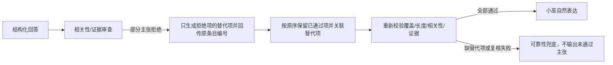
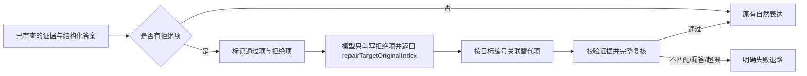

# 联网答案定点修复与保留已通过主张

> 功能名称：联网答案定点修复
> 状态：进行中（离线回归通过；一次真实 Exa 电影验收失败，修复协议更新后尚未真实模型复验）
> 最后核对代码：2026-10-11，当前工作树未提交

## 你会感觉到什么

当联网答案有一条主张被审查拒绝时，小巫只重写那条有问题的内容，保留已经通过的回答。替代项用明确的原条目编号标出目标，因此可以改用另一条有效引文，又不会因为多个条目共享同一问项而串错。替代内容仍须通过引文、范围和问项覆盖检查；目标编号或证据无效时继续拒绝回答，不会强行拼接。

## 当前位置

## 本次触及的位置

## 计划或完成后的状态

## 变化清单

| 项目 | 当前 | 修改后 | 状态 | 代码依据 |
|---|---|---|---|---|
| 被拒答案修订 | 全文重写可能重开已解决问题；过度依赖原引文编号会拒收更合适的替代引文；只靠宽泛问项编号又可能把替代项串给同问项的另一主张 | 模型必须为每条替代项回传 `repairTargetOriginalIndex`；程序只映射到同类型、同目标编号且问项有交集的拒绝项，保留其他通过项 | 已实施；模型未给目标编号则失败关闭 | `src/brain/glm.ts`：`finishStructuredResearchAnswer`、`mergeTargetedAnswerRepair` |
| 修订后安全检查 | 重新生成文本后，可能遗失明确问项或超出边界 | 合并前新引文必须由解析器验证为本轮 supported/conflicting 卡片的真实逐字引文；限制项必须绑定 insufficient 卡。合并后再检查覆盖、条数、2000 字，并执行完整相关性/证据审查 | 已实施 | `src/brain/glm.ts`：`parseStructuredResearchAnswer`、`auditResearchAnswer` |
| 单一对话主链 | 搜索/证据/小巫表达各阶段由同一联网答复链衔接 | 未改变；定点修复只发生在结构化答案生成阶段 | 已实施 | `src/brain/glm.ts` |

## 没有改变什么

- 搜索后端、查询规划、Exa/智谱/Brave 调用方式未改变。
- QQ、本地窗口、人格、记忆、权限和部署状态未改变。
- 不通过固定短语或正则识别用户语义；修订由带原问题、证据和审查意见的模型完成，程序只按审查返回的索引和模型回传的 `repairTargetOriginalIndex` 做结构匹配。新证据引用另行校验并完整复审。
- 这不是答案事实准确性的自动证明，模型审查通过仍需对来源和具体事实进行人工复核。

## 风险和验证

| 可能出错的位置 | 用户看到的表现 | 隔离或回退方式 | 验证方法 | 结果 |
|---|---|---|---|---|
| 模型没有返回有效目标编号/引文的替代项 | 该轮以可靠性兜底结束 | 不把未匹配内容拼回答案 | 离线定点修订故障注入 | `glm-smoke` 与全量 `npm run smoke` 通过 |
| 多轮修订令通过项顺序或内容改变 | 回答变动或遗漏，或替代内容串项 | 程序保存已通过项并按原索引插回；显式目标编号约束替代关系；完整复核仍可拒绝 | 离线连续审查覆盖不同证据卡替换、同问项多条拒绝项不串项及已通过答案保留 | `glm-smoke` 通过 |
| 真实复杂问题仍无法稳定修订 | 明确失败提示，不将未经审查答案当成功 | 有限重试后安全失败 | 真实 Exa 电影检索：3 次 Search、2 次 Contents、8 次 GLM，初版合成失败；目标编号协议随后对相同已保存结果重放 8 次 GLM、0 次 Exa，机械审查通过。报告分别为 `runtime/web-search-acceptance/exa-live-2026-10-10T21-06-51-880Z.json` 和 `runtime/web-search-acceptance/glm-retrieved-answer-2026-10-10T21-20-27-402Z.json` | 新协议真实模型重放机械通过；但人工复核发现 Exa 未召回可找到的巨潮资讯网官方公告 PDF，且答案不必要地称实际档期无法确认，电影质量仍不通过 |

## 未确定事项

- 电影题真实 Exa 检索只返回东方财富转载而漏掉巨潮资讯网官方 PDF；独立搜索实际找到了光线传媒公告原文，确认影片已于2025年1月29日在中国大陆公映。当前 GLM 对 Exa 保存结果重放虽然机械通过，但忽略了这条检索缺口的重要性，还多写了“是否改档无法确认”，人工质量仍不通过。五领域当前版本整体验收未完成。
- 马可、日落海和星痕共鸣既往回放复用已保存 Exa 检索结果，不能证明实时召回质量；人工事实/表达核对未完成。
- 当前 Exa 本地累计计数已达 456 的硬上限；GLM 为 1089/1095（本地还余 6 次），智谱搜索计数为 4。这些是本地保守请求计数，不是供应商余额。未部署、未重启、未进行真实 QQ 验收；工作树改动尚未提交。
