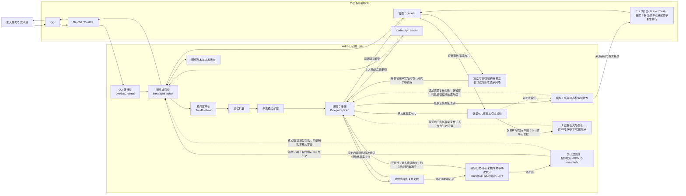
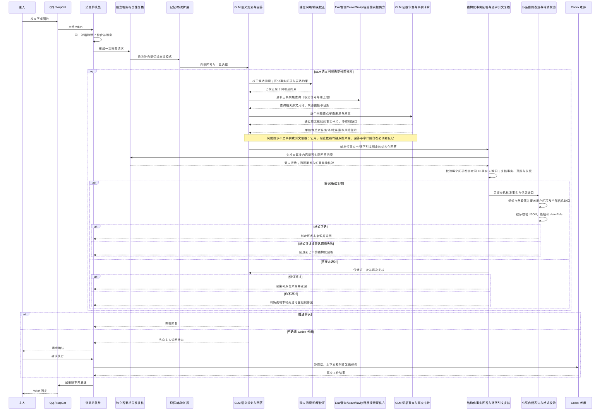
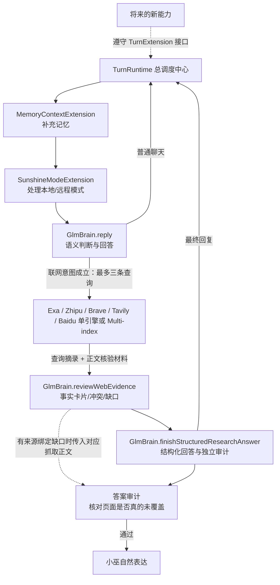
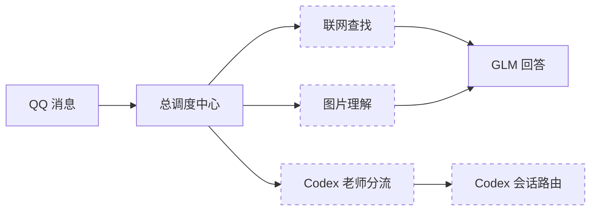

# Witch 架构地图

这份说明写给 Witch 的主人。阅读它不要求会 TypeScript；代码文件只作为“这句话从哪里核对”的证据。

## 先用一句话理解 Witch

Witch 是一个运行在 Windows 后台的 TypeScript 程序：她从 QQ/NapCat 收到消息，把消息交给统一调度中心，按需要补充记忆、联网资料或本地能力，再由 GLM 日常回答，或在主人确认后交给 Codex 老师处理，最后把真实结果发回 QQ。

## 她由什么组成

边界很重要：QQ 和 NapCat 负责账号与消息协议；智谱负责模型和搜索服务；Codex 负责被委派的电脑或复杂任务。Witch 自己负责把这些部分可靠地组织起来。

## 一条消息怎样走完

两个特殊情况不会老老实实等完整流程：

- “停止”会绕过普通消息合并，立即取消当前对话的运行任务并拦截迟到结果。
- 简短确认可以进入快速通道，但同一对话仍只允许一个模型任务同时运行。

## 每个功能具体在哪里

| 你理解的功能 | 它负责什么 | 坏掉时最可能看到什么 | 代码依据 |
|---|---|---|---|
| QQ 接待处 | 接收私聊、下载图片、发送回复 | Witch 离线，或者消息收不到/发不出 | `src/channel/onebot.ts` |
| 消息排队处 | 合并连续消息、串行执行、立即停止、丢弃迟到回复 | 重复回答、漏掉补充消息、停止不生效 | `src/message-batcher.ts` |
| 总调度中心 | 按固定顺序运行能力，并统一管理取消和关闭 | 某个扩展遮住别的能力，或任务停不下来 | `src/runtime/turn-runtime.ts` |
| 记忆 | 保存明确记忆，并找回相关历史 | 忘记明确要求，或召回无关内容 | `src/memory/`、`src/brain/memory.ts` |
| 联网查找 | 独立 GLM 规划判断是否联网并组织最多三条查询；显式选择 Exa、智谱、Brave、Tavily、百度或并行索引提供搜索材料 | 不搜、搜错话题、证据不够、来源不足 | `src/brain/glm.ts`、`src/brain/web-search.ts` |
| 图片理解 | 暂存 QQ 图片，并把真实图片交给完整模型回答路径 | 只能描述大概，无法识别具体对象 | `src/attachments.ts`、`src/brain/glm.ts` |
| 日常大脑 | 理解对话、结合图片/搜索证据回答 | 回答不聪明或没利用到上下文 | `src/brain/glm.ts` |
| Codex 老师分流 | 判断普通聊天还是请老师；失败时回到自由回答 | 不必要地找老师，或该找时没有找 | `src/brain/delegating.ts` |
| Codex 会话路由 | 找到项目和教室、请求确认、等待与停止 Codex | 找错会话、找不到会话、等待过久 | `src/brain/codex-router.ts`、`src/codex-app-server.ts` |
| 消息账本 | 保存近期真实收发记录 | “刚才说的”无法恢复，或上下文断裂 | `src/message-ledger.ts` |
| 后台守护 | 启动 NapCat 和 Witch，检查健康并自动恢复 | 重启电脑后 Witch 不在线，或者出现黑框 | `scripts/watch-bridge.mjs`、`scripts/start-bridge-hidden.vbs` |

## 现在的“可插拔”是什么意思

生产联网不是独立 `TurnExtension`：`src/index.ts` 把配置的 Exa、智谱、Brave、Tavily、百度单一提供方或显式多索引组合注入 `GlmBrain`，由 `GlmBrain.reply()` 统一规划查询、检索、证据审核和表达；`TurnRuntime` 负责外层生命周期、停止和取消。Brave、Tavily 与百度适配器只把来源链接和预提取片段接入同一审核链，不单独生成答案；新增提供方仍需真实检索验收。`src/brain/web-search.ts` 中旧的 `WebSearchExtension` 没有在生产装配中注册，其正则路由测试不能算当前生产联网的验收证据；后续应清理或明确隔离这条遗留路径，避免维护者误以为存在两条活动搜索链。

## 当前三个专项规划会改到哪里

下面只是范围图，不表示规划内容已经实施。

  - 联网链当前分层：GLM 规划与范围审查 → 每条查询及当前轮的结构化问项/回答约束传给明确选择的 Exa/智谱/Brave/Tavily/百度适配器；可选多索引组合并行请求独立索引并交错返回候选、记录各 provider 的原始名次 → 依 query 以 RRF 合并名次，并按查询轮转选最多12个证据来源 → 可选正文抓取与逐字引文校验 → 事实卡/风险注记/缺口 → 结构化回答、相关性和事实审查 → 一次小巫自然表达 → 程序校验 JSON、将可合并短段收拢后限制最多3段/700字，并校验问项覆盖及全部信息缺口；存在事实证据的问项还必须保留至少一条事实主张，不能只说本轮无法确认；表达不合格时回退已审结构化答案。自然表达可省略次要事实点，但不能省用户问项或缺口。搜索上下文只含当前轮 `requestedPoints` 和 `responseConstraints`，不含 recent chat history；Exa 将它们加入有长度上限的任务 `objective`，其他后端可忽略不支持的字段。Exa+Brave、Exa+Tavily 每条查询最多15条候选，三引擎组合最多20条；全局候选池最多75。RRF 只比较同一查询下各 provider 的名次，不比较异构原始 score；排名只代表检索相关性线索，绝不代表来源可信、事实成立或相互独立。主张必须引用精确 `evidenceRefs(cardId, quoteId)`，来源 ID 与链接由程序派生。审查风险注记不是证据；其所绑定的正文会随 gap 来源一起进入答案审计。失败的补搜只保留已验证首轮材料并披露缺口。来源分类不等于事实正确，重复 URL/正文会合并证据组，但语义相似转载仍需谨慎人工判断。
  - 2026-10-11 较早一轮验收状态：保存的 Exa 结果回放中，马可 12、日落海 9、星痕共鸣 11 次 GLM，闲聊反例 2 次 GLM 且零搜索；部分答案审查通过，仍待人工逐条复核。哪吒电影题真实 Exa 检索为4次 `/search`、2次 `/contents`（共抓取12页），随后8次 GLM 到上限，未能进入自然表达层；之后额外2次 GLM 对保存材料跑表达层/审查，但原报告没有保存证据审查的 sourceId→URL 映射，旧回放脚本曾按搜索结果数组顺序猜来源 ID。因此这2次调用不能作为引用/归属正确的验收证据；即使模型自审通过，人工仍认为回答冗长且偏资料整理。Exa 也没有找到已知的巨潮资讯网片方公告 PDF（报告来源列表没有 CNINFO 域名），电影题明确不通过。旧报告为 `runtime/web-search-acceptance/exa-live-2026-10-10T21-46-47-903Z.json`、`runtime/web-search-acceptance/glm-expression-replay-2026-10-10T21-51-54-853Z.json`；新的 live artifact 会安全保存准确来源映射，回放在缺映射时零调用退出。当时本地计数 Exa 462、智谱搜索 5、GLM 1099（非供应商后台余额）；后续实测见本节更新。没有部署、重启或 QQ 实测。
  - 来源独立性：进入证据审查前，程序依据去跟踪参数后的规范 URL 和足够长的正文精确指纹分组；相同 `evidenceGroupId` 的页面不能构成冲突或独立印证，答案复核也会收到该分组。页面作者和正文中的账号身份说法分开呈现为作者字段与“页面自述摘录”，不冒充认证。此规则只抓重复 URL/完全相同正文，不判断改写转载或同一新闻稿的语义相似，遇到不确定应保留人工复核。有限真实模型复验（固定页面摘录、非 Exa）已正确保留“计划开启/实际开启未核实”的时态；不替代五类真实搜索验收。
  - Exa 片段排序：Search 返回的 highlights 若有逐项对齐且有效的相似度分数，仅用于稳定排序；不设分数阈值、不把分数当来源可信度。现有字符预算截断时高相似度片段优先，字段缺失/错位时保留原序。`/contents` 只抓正文用于本地核引文，不重做 highlights。离线契约测试通过，真实 Exa 返回和答案质量尚未复验，见 `docs/architecture/2026-10-10-web-search-exa-provider.md`。
  - 页面核引文：同一 URL 被多条搜索查询命中时，去重保留为一个来源并合并各查询摘录；抓正文时 `/contents` 只取受限正文供本机逐字核验，不用一条共享查询覆盖原摘录。正文不传给回答模型。离线合同已测，真实 API 尚未复验，同见联网专项记录。
  - 未确认项与变体表达：事实主张仍必须绑定 `supported/conflicting` 卡片的逐字引文；回答可另用 `limitations` 绑定 `insufficient` 卡片，直接说明本轮证据缺口。用户要求比较来源差异时，若材料有具体方案，不得仅用“无法确定唯一方案”代替逐来源说明。错误绑定状态的 limitation 会被隔离丢弃，不会污染或拖垮独立通过核引文的 claims；答案审核拒绝的 claims/limitations 在一次重写后仍可逐条剔除并复审，不会因为一条不合格主张丢弃全篇。剩余回答仍进入独立覆盖/范围审查，若缺少用户明确问项则必须修订或失败。2026-10-10 新真实日落海验收的 limiter 隔离没有再触发 schema 失败，但仍有无依据的“无命名冲突”与共识过度概括；电影题把上映日期漏在事实卡而未写进 answer，并误把董秘互动转述当公司公告。人工核对仍是通过门槛，机械通过不等于正确。见联网专项记录第二十三轮、第二十四轮。
  - Exa 检索目标：向 Exa `/search` 同时发送 query 和通用 `objective`，明确官方事实优先使用一手资料、攻略问题可使用社区资料、过滤泛化 SEO/广告并保留版本与方案分歧。此字段来自 Exa agent-oriented Search API；离线请求契约测试通过，真实召回效果未测，不能视作来源质量已改善。见联网专项记录第十九轮。
  - 当前轮检索任务上下文：Exa 的 `objective` 过去是静态通用文本，虽然 GLM 已规划问项和来源约束，适配器却只拿到单条查询。现将有限长度的问项与约束作为任务上下文传入适配器；不传原始对话历史，不把回答约束改写成事实问项。Exa 官方文档将 `objective` 定义为单次搜索服务的更大任务目标，并允许说明哪些文档应优先、要提取什么；离线契约测试覆盖字段传递、历史不泄漏与 4096 字符上限。此改动尚无新的 Exa/Brave/智谱线上 A/B，不证明召回改善，见 `docs/architecture/2026-10-11-web-search-task-context.md`。
  - 额度保护：联网验收脚本复用 `scripts/web-search-live-budget.mjs`。三引擎实时验收之后，按本机逐次请求与报告累计 Exa 476 次（含 `/search` 与 `/contents`）、Tavily 11 次、百度 12 次，合计499次提供方请求；两次保存结果回放后GLM累计1138次。三引擎累计上限512，因此剩余13次提供方请求；GLM硬上限1149，剩余11次本地验收预算。默认新增仍为0，每次运行最多新增50次。以上是本地调用计数，不等于供应商账户余额或账单；百度免费额度/后付费状态仍需控制台确认。
  - 真实验收工具：`scripts/web-search-live-acceptance.mjs` 可显式选择 Exa、智谱、Brave、Tavily、百度、`exa-brave`、`exa-tavily`、`exa-brave-tavily` 或 `exa-tavily-baidu`，以同一五题、同一 GLM 回答链和同一人工质量清单验收；每题最多5条查询，逐引擎请求受累计预算拦截。报告按字段白名单记录阶段计数、事实卡/逐字引文、来源关系评估、回答引用、审查结论和耗时，不保存提示词、推理或完整页面正文。电影题 Exa 仍漏掉已知一手公告，回答表达也未过人工质量门槛；新引擎检索对照不等于整链通过。五领域检索/回答验收未完成。
  - 多引擎检索只改变候选召回，不把不同引擎排名当作事实或来源独立性。2026-10-11 固定检索对照以日落海、马可养猪、哪吒电影、星痕共鸣四个查询分别请求 Exa、Tavily、百度各一次，12次全成功；之后两题三引擎整链分别新增14次和10次提供方调用及9次、4次GLM。日落海机械通过但待人工审；马可题首次整链的证据审查模型输出截断，回答未达长度门槛而失败。收紧证据输出上限并修改截断修复策略后，用原保存材料分别回放马可和日落海，分别花11次、15次GLM且零新搜索；均机械通过但仍待人工事实复核，日落海需要多轮答案审查重写，回答仍偏长偏报告体。Exa/Tavily/百度供应商账单及百度余额未核实；电影候选仍未找到已知片方公告原文。固定对照报告 `runtime/web-search-provider-compare/provider-compare-2026-10-11T05-15-36-075Z.json` 不含抓取正文或GLM结果；整链报告见 `docs/architecture/2026-10-11-web-search-provider-compare.md`。
  - 证据输入控制与格式恢复：初始最多3条、补充最多2条查询；单 Exa 每条最多10条，双索引每条最多15条，三引擎每条最多20条，总候选最多75个；正文补抓和证据审查前按查询轮转，最多将12个来源交给模型，并优先抓取轮转后的前8条。证据审查 schema 限制最多8卡、每卡3条引文、6条缺口/审查备注、3条身份自述；截断修复不回灌残缺长 JSON，而基于同批来源重新生成精简结构。离线回归和保存材料回放仍待复验，不代表答案质量通过。
  - 多 provider 名次融合：每条结果附带 query/provider/rank lineage；合并同 URL 时保留每家引擎在该查询中的最好名次，进入证据预算前以 `sum(1 / (60 + rank))` 计算该查询的 RRF 顺序，再跨 query 轮转，兼顾 provider 共识相关性与问题面向覆盖。不使用不同引擎原始分数，不按来源域名伪造权威等级，也不把“多家都搜到同一 URL”当作多份独立证据。官方资料表明语义 reranker 是对初始 BM25/RRF 结果的第二阶段重排；现阶段仅实施低成本 RRF，仍缺基于语义/权威/时效的独立重排与真实 A/B。见 `docs/architecture/2026-10-11-web-search-rrf-ranking.md`。
  - 三引擎证据包与补搜收敛：上一轮马可实测在证据审查阶段截断并在补搜后超时，回答层未运行。现按 distinct provider 数限制证据来源数（1/2/3 家分别最多12/10/9个），三家组合至多补搜1条（每条扇出三家），单/双家至多2条；证据审查输出 token 上限6144、每卡最多2条逐字引文。离线 smoke 通过；使用保存结果的 GLM 回放在来源预算生效后仍在3072 token上限截断，故本轮提高单阶段 token 上限，不放宽原文绑定与缺口保留标准。真实复测待进行。
  - 最新联网调用账本（2026-10-11）：截至最新三引擎电影题，累计 Exa487、Tavily19、百度20，provider526；GLM1174。本轮电影题用14次 provider、11次 GLM，检索找到光线传媒公告相关页面，但回答在答案审计多轮后超时，未进入自然表达。马可保存结果回放已完整通过所有机械阶段（8次 GLM），但需人工事实/风格审查。受控测试上限为 provider560 / GLM1193；默认新增仍为0，每轮最多新增50。上述为本地脚本请求计数，不代表供应商账单或账户余额。
  - 2026-10-11 后续复验账本：三引擎一般游戏题新增8 provider，累计 Exa491、Tavily21、百度22、provider534；保存结果回放的电影、一般游戏、日落海及马可累计推动 GLM 至1264。本地 hard cap 为560 provider / 1291 GLM、默认新增0、每轮最多+50；当前余量26/27。电影来源归属经提示修正后回放通过机械审查；一般游戏回放已补齐玩法模块但未做人工逐条核验；日落海回放区分社区机制与版本缺口；闲聊反例为零搜索。马可案例人工发现同名“棋手/上阵英雄”外推，已补证据约束；复测先因无效风险备注安全失败，过滤无效备注后又遇 GLM HTTP 400 内容安全拦截，尚未通过。Codex 周窗已用3%，未触及剩余10%停止线。详细阶段记录及结果文件见 `docs/architecture/2026-10-11-web-search-provider-compare.md`。测试结论仅限当前工作树/保存结果回放；未部署、未重启、未真实 QQ 验收。
  - 阿里百炼后备探测：正式环境变量里存在 DashScope key 与应用 ID，但原生研究开关均为 false。一次隔离公开问题调用收到 `401 InvalidApiKey`，无模型用量/回答；未开启正式开关、未写配置。阿里百炼不是当前已接入的第四个搜索提供方；需先修复 API 凭据，再单独评估来源引用与成本。
  - 回答证据上下文压缩：每张事实卡进入答案生成/审查时，默认最多保留3条引文，并优先选择不同 `evidenceGroupId`；答案实际引用的逐字引文在审查上下文中强制保留，引用编号仍指向原事实卡原始序号。结构错误或错绑的 limitation 可被隔离，claim 仍必须通过原文绑定，答案审查仍负责检查明确问项是否因此漏答。证据卡、答案复核同时要求枚举对象逐项说明机制/条件；冲突要保留来源日期及明示版本范围；作品概览避免插入未问的赛季/限时旁支。已通过离线测试并在部分 Exa→GLM 实测中重新验证机械链，但这些语义要求仍未通过全部案例的人工验收。
  - 识图规划：重点是图像输入、识别结果的可信度、必要时用图像线索继续联网验证，不应让文字路由器代替真正看图。
- Codex 老师规划：重点是意图判断、确认、会话选择、停止和真实执行状态，不应把普通聊天强行委派。

## 以后怎样展示一次更新

只要改动影响了上面的结构或消息流程，对应规划和交付必须使用 `change-template.md` 展示“当前 → 本次触及 → 计划/完成后”，并说明：

- 主人能感受到什么变化；
- 哪些模块没有改变；
- 失败会被限制在哪里；
- 用什么测试证明没有破坏相邻功能。

局部修复如果不改变架构，也要明确写“架构未变化”，避免你只能靠猜测判断影响范围。

## 证据与可信度

本页描述的是当前代码，而不是理想设计。主要入口和顺序来自 `src/index.ts`；一次对话的生命周期来自 `src/runtime/turn-runtime.ts`；QQ 串行、合并和停止边界来自 `src/channel/onebot.ts` 与 `src/message-batcher.ts`；模型分工来自 `src/brain/delegating.ts`。如果图与这些文件冲突，应以当前可运行代码为准并修正文档。

## 2026-10-11 联网验收增量

| 项目 | 当前 | 本次触及 | 状态与用户可见变化 | 验证/边界 |
|---|---|---|---|---|
| 联网范围审查结构缺字段 | 任一必需数组缺失会直接中断 | `GlmBrain.reviewSearchScope` 对无效 JSON/字段做一次有限格式修复，不替模型猜测独立支持关系 | 已实施；只修结构，不改用户问项含义 | 离线 `glm-smoke` 覆盖字段缺失；真实马可回放通过该阶段，但整轮后续仍失败 |
| 事实 claim 缺引文 | 程序拒绝，但错误只说 `claim schema mismatch`，修复轮看不到前一版原文 | `parseStructuredResearchAnswer` 给出 `evidenceRefs` 专项错误；单次修复可看到限长后的上一版 JSON，并要求不得编造引文、无支持则删除或转成有缺口卡绑定的 limitation | 已实施；不会把无引文的否定句当作事实送出 | 新增离线故障注入验证“空引文 claim → 明确错误 → 有据修复”；完整离线 smoke 通过 |
| 独立来源关系 | 不同 `evidenceGroupId` 只能排除相同 URL/正文，不能证明不同页面不是转载；模型可把 `finding` 中的“不确定”漏到结构化风险外 | 新增 `independenceAssessments`：按用户问项记录同一机制的来源组合及 `independent/syndicated/uncertain`；答案解析和独立审查都要求被引用的来源组合有明确 `independent` 评估，否则 fail-closed | 已实施；关系未知时不再把“不同网址”说成“独立印证” | Helper + live-stage 摘要单测和完整离线 smoke 通过；真实模型是否能稳定填写该结构仍未验证 |
| 答案审查后的重写 | 全文重生成可能修好一个问题又重新引入已修正的旁支/漏答；最后剔除被拒 claim 时可能连同该 claim 中正确的核心答案一起丢掉 | 审查有明确 rejected claim/limitation 索引时只让模型替换被拒条目；替代项显式回传 `repairTargetOriginalIndex`，程序确认目标编号与问项一致、引用/缺口卡有效，按原位保留已通过条目，再完整复审 | 已实施；不再要求替代项复用原引文；目标不明、无效引文或复审失败仍关闭输出 | 离线跨证据卡替换与错目标隔离回归通过；全量 `npm run smoke` 本轮通过。相同 Exa 电影结果真实 GLM 重放 8 次也机械通过，但人工查出 Exa 漏掉可找到的巨潮资讯网公告 PDF，整体质量仍不通过 |
| 真实验收与报告保真 | 电影题完整 Exa 链及旧保存材料上的表达回放 | 新增精确来源映射白名单元数据；表达回放缺映射即在 GLM 调用前退出 | 修复已实施；全量离线 smoke 通过，旧2次表达调用不可追认为通过 | 本轮只补报告/回放完整性，不重跑外部 API；电影题仍失败 |
| 多 provider 来源筛选 | 同 query 各引擎返回名单次交错，12来源预算按 query 均分；没有融合跨引擎排名信号 | 保存每条结果的 provider/query/rank，按 query 用 RRF 排序后仍跨 query 轮转 | 已实施，默认行为只影响显式多 provider 结果筛选；不触碰事实独立性/来源身份判定 | 单元回归覆盖名次融合、跨 query 均衡和单引擎稳定排序；全量 `npm run smoke` 通过。真实来源预算重排和答案质量尚未线上验收 |
| 转载来源独立性 | 只按规范 URL 与完全相同正文分组；跨站转载加导语后可能被误算为独立证据 | 对至少800字符的正文计算5字符 shingles；仅当 Jaccard ≥0.82 或短文对长文的覆盖率 ≥0.94 时合并证据组 | 已实施，保守检测仅用于防止明显转载被算作独立印证；不替代相关性判断，也不自动证明剩余来源独立 | 离线回归覆盖带导语转载合并与同题独立描述不合并；全量 `npm run smoke` 通过。真实页面误合并/漏合并率仍待人工审阅 |
| 本地问答后备模型 | Ollama 的 Qwen 2.5 14B 与 Mistral Nemo 已安装，但是否可用于联网答案未知 | 用已保存检索摘录请求自然作答与严格逐字引用 JSON，并做程序化原文匹配 | 未接入：两种模型都生成摘录之外的阵容/技能/装备/运营事实并违背格式约束 | 本地双模型对照失败；精确引文检查拒收。未调用 provider/API，且停止了本轮启动的 Ollama 服务 |
| 联网回答自然表达轻量化 | 自然表达后还需单独模型审查；审查拒绝或超时会退回卡片式答案 | 只生成一次自然表达；程序校验 JSON、最多3段/700字及 `claimRefs`，超限或格式无效时回退到已核验结构答案 | 已实施于当前工作树；预期减少一次常规模型调用并保留小巫口吻 | `glm-smoke` 验证自然表达不再等待第二次模型审批、超限触发退路且来源绑定仍由程序生成；真实 API、风格稳定性和正式 QQ 尚未验证 |

2026-10-11 人工核验纠错与引用问项边界：保存样本第一次人工记录把星痕共鸣同一事实卡中的两个 quoteId 对调，复查后纠正为匹配；马可养猪样本仍发现运营 claim 引用到机制卡，以及“棋手/上阵英雄”结论缺少上阵英雄侧的直接证据。新增结构约束：claim 与 limitation 按单个问项表达，claim 必须引用覆盖该问项 ID 的事实卡，limitation 必须引用该问项自己的 insufficient 卡；规划和范围审查也要求把明确比较的每一侧拆为单独问项。它不能证明卡片内每句话都被引文蕴含，也不能保证模型一定按要求拆项，因此保存样本仍有人工失败项，轻量版尚未达到可接受状态。离线回归只验证程序拒绝结构错配，不能当作实时检索或真实模型质量通过。

2026-10-11 逐侧问项绑定：规划器/范围审查器收到明确比较、区分两个实体/身份/方案时，须把每侧拆成独立 `requestedPoint`；证据审查为每侧分别建立卡片或 `insufficient` 缺口。程序拒绝未能为 claim 中每个问项提供同 ID 证据卡引用的情况，也拒绝引用不同问项的缺口卡。离线 smoke 用保存的马可问题形状验证：棋手卡不能单独支撑上阵英雄结论，英雄侧必须由其自己的卡片或明确缺口回答。该改动仍需真实规划/回答样本人工验收；GLM 评审可漏判语义错配，因此自动审查结果不算人工通过。参考：ACL 2025 GroUSE 研究也指出自动化 grounded QA 评审会漏掉模型输出中的失败类型（[论文页面](https://aclanthology.org/2025.coling-main.304/)）；它支持采用逐项结构约束的动机，不构成本项目验收证据。

2026-10-11 小巫答复篇幅：保存答案的人工抽查显示多次回答拉成长篇资料整理。自然表达提示目标为普通问题通常1–2段、100–300字，多问项通常最多3段、450字；程序硬限3段/700字，并要求至少覆盖每个用户问项、保留全部已审信息缺口。次要事实要点可省略，避免把所有审查细节逐条复述。超过硬限则回退已核实结构答案；真实 GLM 输出是否变简洁仍待实测，不能由离线合同测试推断。

2026-10-11 篇幅约束补强：提示层偏好不能单独保证模型简洁；自然表达解析器现拒绝超过3段、单段400字或总计700字的内容，并回退到结构化答案。离线 smoke 验证拒绝路径。该退路仍可能较长，且未对新提示进行真实 GLM 验收；详见 `docs/architecture/2026-10-11-web-search-mvp-expression.md` 与 `docs/architecture/2026-10-11-web-search-saved-answer-review.md`。
