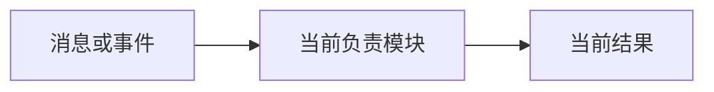
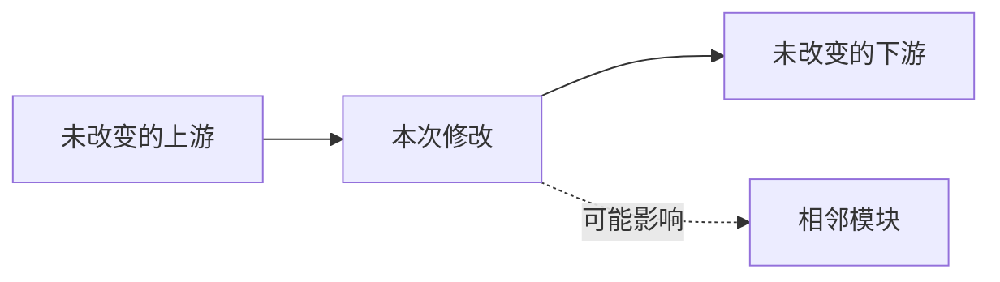
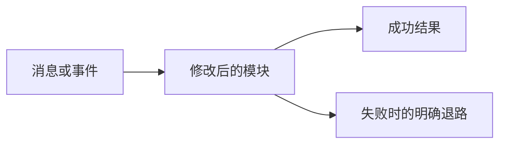

# 功能可视化变更说明模板

> 功能名称：`填写名称`  
> 状态：`规划 / 实施中 / 已完成未验证 / 已验证`  
> 最后核对代码：`提交号或日期`

## 你会感觉到什么

用不超过三句话说明主人在 QQ 或电脑上能直接感受到的变化。不要先讲类名、接口或技术栈。

## 当前位置

## 本次触及的位置

## 计划或完成后的状态

## 变化清单

| 项目 | 当前 | 修改后 | 状态 | 代码依据 |
|---|---|---|---|---|
| 示例 | 当前行为 | 目标行为 | 计划/完成/验证 | `src/example.ts` |

## 没有改变什么

- 写出明确不在本次范围内的模块。
- 如果复用了接口但没有改变行为，也在这里说明。

## 风险和验证

| 可能出错的位置 | 用户看到的表现 | 隔离或回退方式 | 验证方法 | 结果 |
|---|---|---|---|---|
| 示例 | 示例表现 | 示例退路 | 示例测试 | 未运行/通过/失败 |

## 未确定事项

把尚未从代码、日志或测试中确认的内容列在这里；不要画成已经完成。

